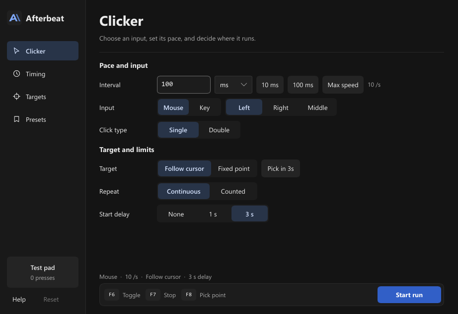

# Afterbeat

Afterbeat is a desktop auto-clicker and key repeater for x64 Windows 10 and 11, x64 Linux desktops running X11 or Wayland, and macOS 13 or later on Apple silicon and Intel. Click at the pointer, at a saved point, or along a route, or send repeated keystrokes to the focused app. Preview your targets and set where the run can operate and when it should stop.

[Downloads](https://github.com/XeinTDM/Afterbeat/releases) · [User guide](docs/usage.md) · [Build from source](docs/build.md) · [Benchmarks](docs/benchmarks.md)

## Get started

1. On Windows, run the direct `.exe` if listed, or extract the Windows ZIP and open `afterbeat.exe`. On Linux or macOS, extract the archive and run `./afterbeat` or open `Afterbeat.app`. On Wayland and macOS, grant input permission through your desktop. [Releases](https://github.com/XeinTDM/Afterbeat/releases) · [Platform setup](docs/usage.md#install-and-update) · [Verify a download](docs/releasing.md#verify-a-download)
2. On **Clicker**, choose the input, pace, target, and repeat mode. The default is a left click every 100 ms with a three-second countdown.
3. Press **F6** or select **Start run**, then move over the **Test pad** to see the clicks arrive. Press **F7** to stop.

| Default shortcut | Action |
| --- | --- |
| **F6** | Start or stop. In Hold mode, run while the shortcut is held. |
| **F7** | Emergency stop or cancel a pending capture. |
| **F8** | Capture a point or zone corner at the pointer. |

## Set up a run

- Use fixed or variable intervals, counted repeats, time limits, and timed presses.
- Save up to 64 points in a route. Use **Targets → Dry run** to preview points and zones without sending input.
- Use stop zones, monitor edges, and app filters to constrain a run. Save the whole setup under **Presets**.
- Choose **Precise** for steadier click spacing or **Low CPU** to batch compatible mouse clicks. [Pacing and eligibility](docs/usage.md#precise-and-low-cpu)

## Measured pacing

At a target of 1,000 clicks per second under CPU load, Precise delivered 987.2 CPS with 0.57 ms p99 spacing error. Low CPU delivered 999.4 CPS with 2.46 ms p99 spacing error and used 1.2% of one logical CPU, compared with 39.3% for Precise. These figures come from five trials per mode on one Windows 11 machine. [Methodology, peer results, and raw trials](docs/benchmarks.md)

## Project

[Contributing](CONTRIBUTING.md) · [Security](SECURITY.md) · [Changelog](CHANGELOG.md) · [MIT license](LICENSE) · [Third-party notices](THIRD-PARTY-NOTICES.txt)

Afterbeat uses [Slint](https://slint.dev/) for its desktop interface.
