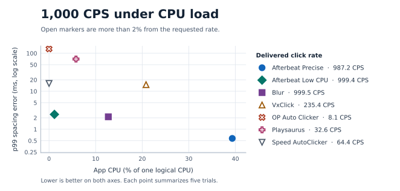

# Input delivery benchmarks

## Run the Afterbeat delivery harness

The source-tree runner measures Afterbeat Precise and Low CPU against a separate Win32 receiver. It uses F6 to start and F7 or its Ctrl+Alt+F7 fallback to measure emergency stop. Its default benchmark uses five-second windows and a seeded shuffle of the individual trials. Use `--load` to add trials with two busy workers per app CPU. Run it in an interactive Windows test session with Afterbeat closed. The private desktop stays active for the whole run, which can take several minutes for a benchmark.

```powershell
cargo build --release --locked
py -3.12 -m pip install -r scripts/delivery/requirements.txt
py -3.12 -B scripts/delivery/run.py smoke
py -3.12 -B scripts/delivery/run.py benchmark --load
```

Each run saves a manifest with binary and harness SHA-256 hashes, environment, affinity, and trial order. Each trial saves its settings, measurement boundaries, and the receiver's raw button events. Replay takes the printed run directory and regenerates the CSVs without running Afterbeat.

```powershell
$run = 'target/delivery/<run-id>'
py -3.12 -B scripts/delivery/results.py $run
```

The runner reports p99 spacing error only when a trial has at least 100 measured gaps. The stop tail is a lower bound when marked censored. Receiver timestamps measure when the window processed each event. The historical peer comparison below uses a separate protocol with an F6 toggle stop.

The Windows smoke run also checks Smart Targets against native Win32 controls. It runs ten Export → Save routes with relocated windows and varying delays before enabling Save. It also checks ambiguous controls and windows, an overlapping window, emergency stop, and verification timeout. Its `smart-targets/result.json` records route completion, unexpected clicks, individual and p95 enable-to-click latency, and the time from emergency stop to the on-screen stopped state.

Run the targeted visual benchmark with `py -3.12 -B scripts/delivery/run.py visual-targets`. It writes `visual-targets/result.json` with combined accessibility ID and window-title changes, a decoy moved beside the saved position, a disabled intended control, reused IDs, duplicate or missing anchors, and stale and successful repairs. The harness redraws native controls at 150% size and separately attempts a real cross-monitor DPI transition. It records a skip with the observed DPI values when the desktop lacks differently scaled monitors. The Rust tests check normalized fingerprints and geometry at multiple pixel scales.

Run `py -3.12 -B scripts/delivery/run.py route-actions` to check mixed routes and Clicker output on an isolated Windows desktop. The native fixture records tagged button and key edges and signed wheel deltas in receiver order. It checks timing, delayed targets, focus changes, stop during a wait, and a time limit before first input. The same fixture checks both side-button IDs, exact triple-click counts, wheel configuration from the Clicker UI, and wheel delivery to the intended window. Results go to `route-actions/result.json`.

## Run the peer comparison from a clean checkout

Use the [Windows build prerequisites](build.md) and an interactive, disposable Windows profile with the clickers closed. The benchmark launches the pinned portable peer releases as the current user. It refuses to start if it finds existing peer settings in the known profile directories it uses. Keep the session untouched until the private test desktop returns.

```powershell
cargo build --release --locked
py -3.12 -m pip install -r scripts/delivery/requirements.txt
py -3.12 -B scripts/delivery/run.py fetch-peers
py -3.12 -B scripts/delivery/run.py peers --disposable-profile --load
```

[`peers.lock.json`](../scripts/delivery/peers.lock.json) pins five releases by publisher URL, version, executable path, and SHA-256. `fetch-peers` fills `target/delivery/peer-cache`. For an offline run or an unavailable publisher URL, place the exact release files in the cache with the names in the lockfile. Both commands accept `--cache` and verify each artifact before use. The runner records the package and staged executable hashes, the settings seeded for each trial, and the configuration readback for peers set through Windows controls. A run interrupted before cleanup may leave a reserved settings directory in the disposable profile.

The default matrix runs both Afterbeat modes and all five peers at 100, 500, and 1,000 CPS, with five repetitions per condition. `--load` includes both idle and loaded trials. For a seven-trial pilot, use `peers --disposable-profile --rates 100 --seconds 1 --repetitions 1`. Select a smaller set of peers with `--peer blur vxclick op playsaurus speed` on both commands.

Every entry uses a 150 ms F6 press to start and stop. The current runner launches a fresh process for each trial, shuffles individual trials with a recorded seed, and measures five seconds after a 300 ms warmup. This differs from the historical comparison's grouped trials and shorter measurement windows. The run directory contains `trials.csv`, `summary.csv`, and raw Win32 receiver events. Use the replay command above to regenerate both reports.

## Historical peer comparison

Both Afterbeat modes and five other Windows clickers ran in one session at 100, 500, and 1,000 CPS, idle and under CPU load. The 210 trials cover one machine and one receiver workload.

## 1,000 CPS under CPU load

Afterbeat Precise had the tightest spacing at 0.57 ms p99. Afterbeat Low CPU delivered 999.4 CPS at 1.2% CPU, the lowest CPU use among entries within 2% of target. Blur delivered 999.5 CPS and had no button edge after the stop toggle in its five trials.



Precise had the lowest p99 spacing error at all three targets under load. VxClick led on spacing at all three idle targets. Low CPU used the least CPU among entries within 2% of target at 500 and 1,000 CPS in both conditions. At 100 CPS under load it delivered 65.2 CPS, while Precise delivered 100.0 CPS.

## Full results

[Download all 210 raw trials (CSV)](data/expanded-comparison.csv)

### 100 CPS

| App or mode | Condition | Delivered CPS | CPU | p99 spacing error | Worst stop tail |
| --- | --- | ---: | ---: | ---: | ---: |
| Afterbeat Precise | Idle | 99.9 | 1.2% | 1.80 ms | 1.74 ms |
| Afterbeat Precise | CPU load | 100.0 | 1.2% | 0.97 ms | 0.66 ms |
| Afterbeat Low CPU | Idle | 100.7 | 2.3% | 11.10 ms | 0.00 ms |
| Afterbeat Low CPU | CPU load | 65.2 | 1.2% | 70.35 ms | 1.01 ms |
| Blur | Idle | 100.7 | 4.6% | 10.38 ms | 0.00 ms |
| Blur | CPU load | 99.2 | 5.8% | 10.46 ms | 0.50 ms |
| VxClick | Idle | 100.0 | 26.6% | 1.15 ms | 0.16 ms |
| VxClick | CPU load | 92.6 | 20.8% | 13.35 ms | 34.67 ms |
| OP Auto Clicker | Idle | 27.4 | 66.0% | 36.97 ms | 9.90 ms |
| OP Auto Clicker | CPU load | 5.2 | 0.0% | 187.70 ms | 0.32 ms |
| Playsaurus | Idle | 94.8 | 4.6% | 1.50 ms | 0.69 ms |
| Playsaurus | CPU load | 29.6 | 6.9% | 31.13 ms | 44.39 ms |
| Speed AutoClicker | Idle | 63.7 | 0.0% | 7.31 ms | 16.19 ms |
| Speed AutoClicker | CPU load | 64.4 | 0.0% | 6.77 ms | 138.33 ms |

### 500 CPS

| App or mode | Condition | Delivered CPS | CPU | p99 spacing error | Worst stop tail |
| --- | --- | ---: | ---: | ---: | ---: |
| Afterbeat Precise | Idle | 498.2 | 12.7% | 1.02 ms | 1.70 ms |
| Afterbeat Precise | CPU load | 499.0 | 23.1% | 0.63 ms | 0.55 ms |
| Afterbeat Low CPU | Idle | 497.7 | 2.3% | 3.06 ms | 0.00 ms |
| Afterbeat Low CPU | CPU load | 499.2 | 2.3% | 2.60 ms | 0.00 ms |
| Blur | Idle | 500.5 | 10.4% | 2.73 ms | 0.00 ms |
| Blur | CPU load | 499.1 | 8.1% | 2.58 ms | 0.00 ms |
| VxClick | Idle | 497.6 | 98.4% | 0.78 ms | 0.50 ms |
| VxClick | CPU load | 183.6 | 19.7% | 14.51 ms | 32.68 ms |
| OP Auto Clicker | Idle | 49.6 | 97.2% | 19.33 ms | 8.75 ms |
| OP Auto Clicker | CPU load | 8.1 | 0.0% | 132.94 ms | 0.34 ms |
| Playsaurus | Idle | 400.5 | 12.7% | 1.38 ms | 0.50 ms |
| Playsaurus | CPU load | 29.6 | 1.2% | 64.08 ms | 60.87 ms |
| Speed AutoClicker | Idle | 63.7 | 0.0% | 15.37 ms | 12.02 ms |
| Speed AutoClicker | CPU load | 63.7 | 0.0% | 14.95 ms | 175.55 ms |

### 1,000 CPS

| App or mode | Condition | Delivered CPS | CPU | p99 spacing error | Worst stop tail |
| --- | --- | ---: | ---: | ---: | ---: |
| Afterbeat Precise | Idle | 981.9 | 31.2% | 0.76 ms | 1.18 ms |
| Afterbeat Precise | CPU load | 987.2 | 39.3% | 0.57 ms | 0.61 ms |
| Afterbeat Low CPU | Idle | 992.7 | 2.3% | 2.81 ms | 2.08 ms |
| Afterbeat Low CPU | CPU load | 999.4 | 1.2% | 2.46 ms | 0.98 ms |
| Blur | Idle | 998.9 | 11.6% | 2.19 ms | 1.88 ms |
| Blur | CPU load | 999.5 | 12.7% | 2.13 ms | 0.00 ms |
| VxClick | Idle | 991.4 | 90.2% | 0.65 ms | 1.45 ms |
| VxClick | CPU load | 235.4 | 20.8% | 14.91 ms | 40.45 ms |
| OP Auto Clicker | Idle | 49.6 | 99.5% | 19.86 ms | 7.73 ms |
| OP Auto Clicker | CPU load | 8.1 | 0.0% | 130.53 ms | 0.33 ms |
| Playsaurus | Idle | 625.0 | 22.0% | 1.60 ms | 0.96 ms |
| Playsaurus | CPU load | 32.6 | 5.8% | 70.33 ms | 62.24 ms |
| Speed AutoClicker | Idle | 63.7 | 0.0% | 16.10 ms | 13.74 ms |
| Speed AutoClicker | CPU load | 64.4 | 0.0% | 16.06 ms | 109.66 ms |

## Test method

- **Hardware.** Core i7-10700KF, Windows 11 Pro build 26300. Each app ran minimized and pinned to the same two logical CPUs (12 and 14, zero-based). The Win32 receiver ran on the other CPUs. CPU load added two normal-priority busy workers to each of the app's CPUs. Idle means no added load.
- **Workload.** Fixed-rate, continuous left clicks at the pointer on an isolated Windows desktop. All apps used F6 to toggle. Randomization was off. OP Auto Clicker and Playsaurus accepted intervals of 10, 2, and 1 ms, shown in the tables as nominal 100, 500, and 1,000 CPS. Playsaurus displayed its own lower estimates of about 80, 222, and 286 CPS at those settings. Speed AutoClicker used 0% duty cycle for taps.
- **Trials.** The harness shuffled the 21 app-and-rate blocks and alternated the idle/load order. It used 150 ms F6 presses and measured about 1.35 seconds of output per trial after a 260 ms warmup, five trials per condition. The receiver timestamped each button edge and checked the tags from Afterbeat, Blur, and VxClick. The other apps emitted zero tags and ran one at a time on the same isolated desktop.
- **Delivered CPS.** Median across trials of the number of button-down events received per second in the measurement window.
- **CPU.** Median app process-tree CPU time as a percentage of one logical CPU, excluding the receiver and load workers. A reported 0.0% means the median rounded to zero at this measurement resolution.
- **p99 spacing error.** For consecutive button-downs, take the absolute difference between their gap and the nominal interval. Take the 99th percentile within each trial, then the median across trials with at least two clicks. A steady stream at the wrong rate can still show a small spacing error, so read it alongside delivered CPS.
- **Worst stop tail.** Longest time from sending F6 key-down to the last button edge across five trials, observed for 500 ms. Zero means the receiver recorded no edge after F6. If a trial still had clicks in the final 175 ms of observation, the table reports the last edge as a lower bound and the harness restarts the app for the next trial.

The tested build was Afterbeat 1.2.6. The peer builds came from their publishers. [Blur 3.10.2](https://github.com/Blur009/Blur-AutoClicker/releases/tag/v3.10.2) · [VxClick 1.0.5](https://github.com/Vxiey/VxClick/releases/tag/v1.0.5) · [OP Auto Clicker 4.1](https://sourceforge.net/projects/orphamielautoclicker/files/4.1/) · [Playsaurus 2.1.3 Free Portable](https://autoclicker.com/download) · [Speed AutoClicker 1.6.2](https://fabi.me/en/tools/speed-autoclicker/)

## Pacing recovery rerun

Native tracing found that some Windows `SendInput` calls took about 9 ms. The receiver counted every submitted click, but the delay left fewer opportunities to send the next one. The updated scheduler carries forward up to 8 ms of schedule lag and recovers it over later submissions with a minimum spacing. Windows stalls can still cause uneven delivery.

Two release builds from the same source snapshot isolated the pacing change. Afterbeat ran minimized on the same two logical CPUs used in the head-to-head test. The Win32 receiver measured about 1.35 seconds per trial and ran on the remaining CPUs. There were 32 trials, two per build, mode, target, and load condition. The load test added two busy workers per app CPU. Background compilation was active on the host, including during the runs with no added load.

Values show **before → after**. Delivered CPS, CPU use, and p99 spacing error are medians across the two trials. The stop tail is the longest observed in either trial. CPU use is a percentage of one logical CPU.

| Target CPS | Mode | Condition | Delivered CPS | CPU | p99 spacing error | Worst stop tail |
| ---: | --- | --- | ---: | ---: | ---: | ---: |
| 500 | Precise | No added load | 496.5 → 498.3 | 22.6% → 19.7% | 0.66 → 0.76 ms | 0.00 → 0.00 ms |
| 500 | Precise | CPU load | 493.9 → 499.9 | 19.1% → 22.0% | 0.76 → 0.90 ms | 0.53 → 0.00 ms |
| 500 | Low CPU | No added load | 499.1 → 500.6 | 4.6% → 4.0% | 2.51 → 2.60 ms | 1.15 → 0.00 ms |
| 500 | Low CPU | CPU load | 491.7 → 500.6 | 4.0% → 5.8% | 3.97 → 2.54 ms | 0.00 → 0.00 ms |
| 1,000 | Precise | No added load | 976.6 → 991.4 | 38.8% → 38.2% | 0.79 → 0.79 ms | 4.82 → 2.36 ms |
| 1,000 | Precise | CPU load | 950.7 → 995.8 | 34.1% → 38.2% | 2.37 → 0.65 ms | 0.00 → 0.00 ms |
| 1,000 | Low CPU | No added load | 996.2 → 999.6 | 3.5% → 1.2% | 2.30 → 2.36 ms | 1.68 → 1.02 ms |
| 1,000 | Low CPU | CPU load | 998.5 → 997.4 | 3.5% → 3.5% | 2.35 → 2.41 ms | 0.00 → 0.72 ms |

## Earlier runs

### Precise vs. Low CPU

This separate run supplies the README table. Both modes ran from the same Afterbeat 1.2.6 build. Low CPU used 70–95% less app CPU in this test. At 1,000 CPS under load it delivered 995.3 clicks/s at 2.3% CPU, with a 2.97 ms p99 spacing error.

| Target CPS | Condition | Mode | Delivered CPS | CPU | p99 spacing error | Worst stop tail |
| ---: | --- | --- | ---: | ---: | ---: | ---: |
| 500 | Idle | Precise | 499.1 | 11.6% | 0.99 ms | 0.86 ms |
| 500 | Idle | Low CPU | 494.4 | 3.5% | 3.95 ms | 1.85 ms |
| 500 | CPU load | Precise | 499.8 | 23.1% | 0.61 ms | 0.00 ms |
| 500 | CPU load | Low CPU | 499.1 | 1.2% | 3.66 ms | 0.00 ms |
| 1,000 | Idle | Precise | 992.1 | 35.9% | 0.74 ms | 1.56 ms |
| 1,000 | Idle | Low CPU | 988.4 | 4.6% | 3.49 ms | 2.09 ms |
| 1,000 | CPU load | Precise | 998.9 | 37.0% | 0.53 ms | 0.57 ms |
| 1,000 | CPU load | Low CPU | 995.3 | 2.3% | 2.97 ms | 0.55 ms |

[Raw pacing trials (CSV)](data/pacing.csv)

The earlier peer comparison used the same machine and receiver before Low CPU was added. For Afterbeat’s precise scheduler, use the CSV’s `Afterbeat` rows at 100 CPS and `Afterbeat baseline` rows at 500 and 1,000 CPS. [Raw earlier comparison (CSV)](data/peer-comparison.csv)
